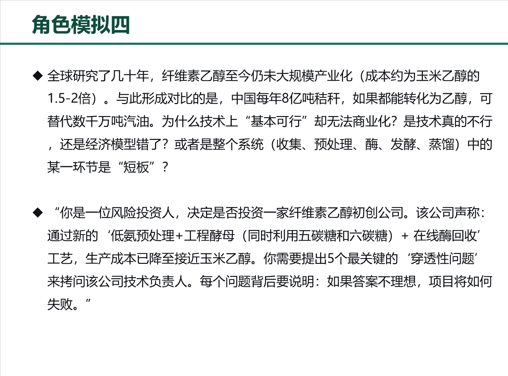

现在有两个任务 
1、角色模拟。自由组队选题，每组进行课堂报告。需展示组内同学的
具体贡献。
2、课堂汇报。自选一个具体的环境问题，结合相关方向产业化最新进
展，提出一套生物技术解决方案，PPT汇报，10分钟

现在需要你对任务一，进行文献调研，完成其中的内容，从背景到技术，然后再到模拟实践，条理清晰

对任务二：同样进行文献调研，自选一个具体的环境问题，阐明相关方向产业化最新进成果，
同时采用交叉学科知识，将计算机相关技术运用于此， 给出相对完善的算法设计和生物技术解决方案
该算法需要完善可行，可以复用计算机领域的相关算法，该算法需要输出相关的指标和结果矢量图

再完成这两项之后进行分别的PPT制作，PPT模版参考我给你的纳米生物技术汇报，使用相同风格和模版，文件风格命名相同

